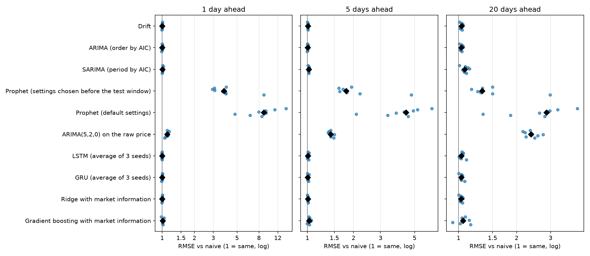
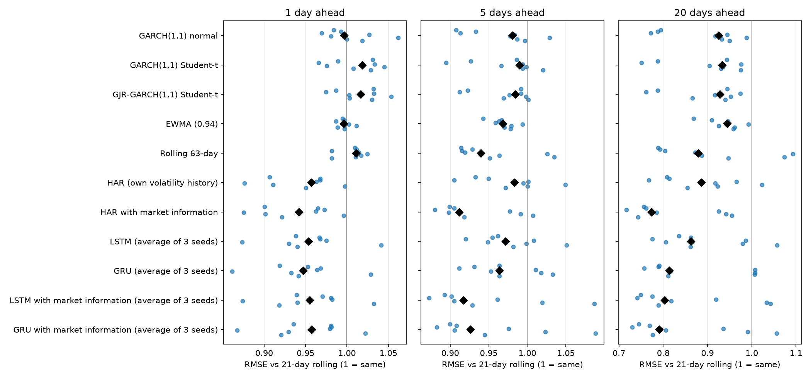
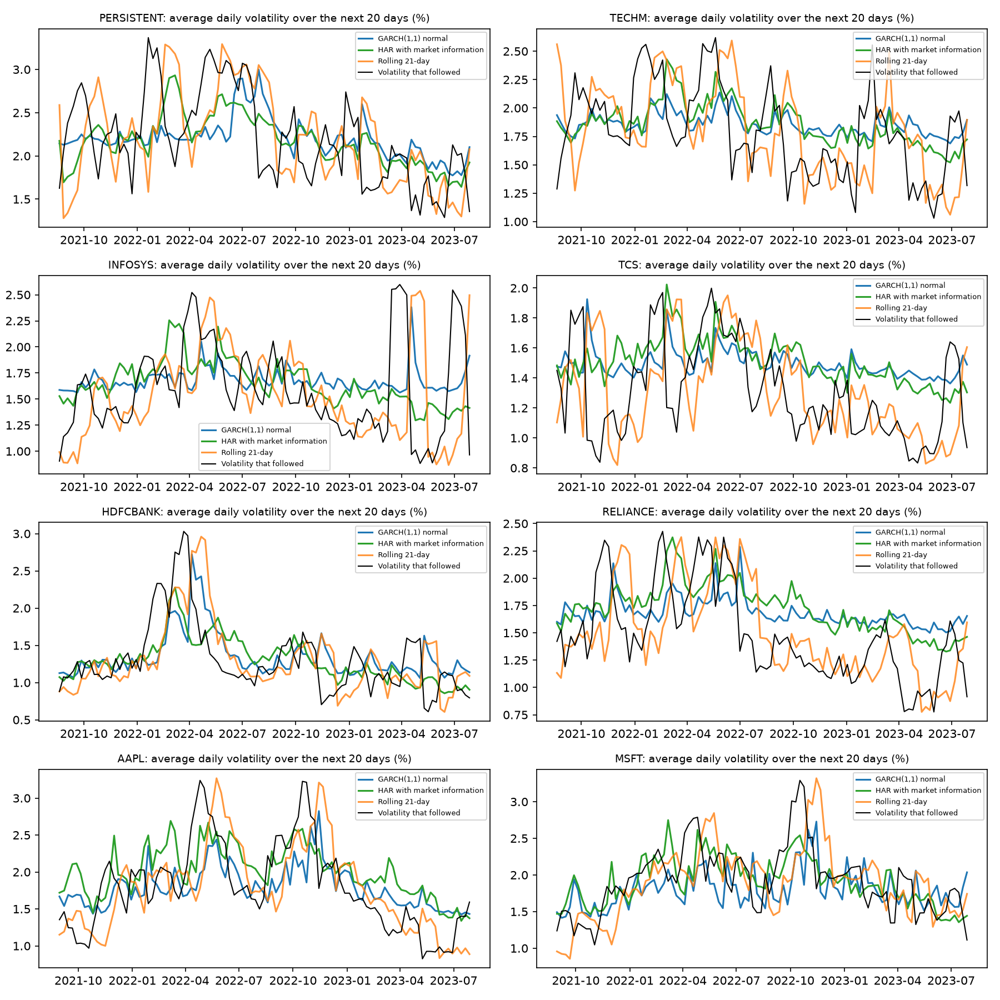
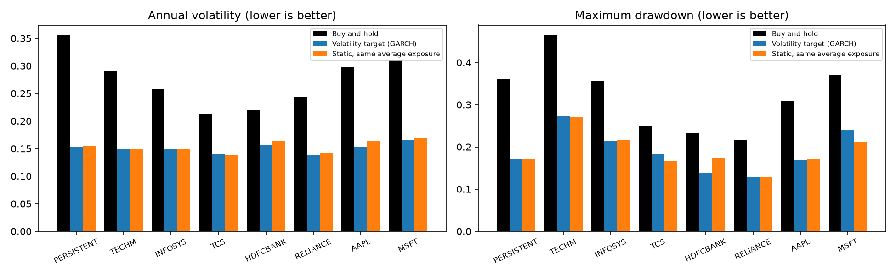
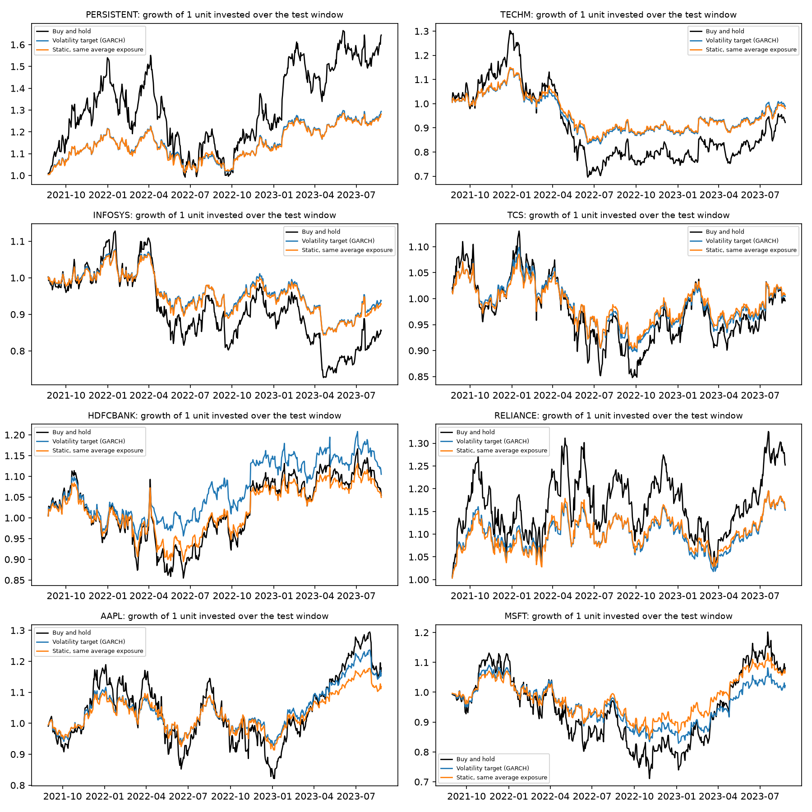

# Stocks Prediction Using Time Series Models

Walk-forward tests of ARIMA, SARIMA, Prophet, GARCH, HAR, LSTM, GRU, ridge regression and gradient boosting on eight stocks: six NSE-listed Indian stocks and Apple and Microsoft. Every stock gets exactly the same models and the same tests. The price models are judged against a naive baseline that simply repeats the last close, the volatility models are judged against a 21-day rolling volatility baseline, and the volatility forecasts are then used to size a position in a volatility-targeting backtest.

**Findings**

- **No price model beat the baseline.** Of 240 comparisons (10 models, 3 horizons, 8 stocks), only 25 had a lower error than repeating the last close, by at most 6.8% and never significantly. That includes LSTM, GRU, ridge regression and gradient boosting given market information.
- **ARIMA matches the baseline.** Its error is 1.00, 1.00 and 1.04 times the baseline's at 1, 5 and 20 days (median over the eight stocks), and the up-or-down call of ARIMA, SARIMA and drift is right 41% to 58% of the time (median 52%).
- **SARIMA finds no seasonality.** For six of the eight stocks a weekly or monthly seasonal term makes the AIC worse, and for the other two it improves it by 0.3 and 0.1, which is nothing.
- **Prophet is worse than the baseline in every stock.** Its error is a median 3.8, 1.8 and 1.3 times the baseline's with settings chosen before the test window, and 8.9, 4.4 and 2.9 times with default settings.
- **ARIMA(5,2,0) on the raw price is 1.1 to 2.4 times worse** than the baseline, significantly so in at least seven of the eight stocks at every horizon.
- **Volatility is predictable, and market information helps.** GARCH(1,1) forecasts 20-day volatility 7% more accurately than a 21-day rolling window (median), better in all eight stocks and significantly so in three. A HAR model that also sees the market index and the fear index (VIX or India VIX) is the best forecaster: 23% more accurate than the rolling window, better in all eight stocks and significantly so in five.
- **That beats GARCH in every stock.** HAR with market information has a lower 20-day error than GARCH(1,1) in all eight stocks (median 5% lower; significantly lower in one, never significantly higher). The stocks are not independent of one another, so eight out of eight is strong but not conclusive.
- **A simple model does as well as the neural networks.** The LSTM and GRU with market information reach 0.80 and 0.79 of the baseline's 20-day error, against 0.77 for the HAR regression.
- **Volatility targeting cuts risk, but mostly by holding less.** Sizing a position with the GARCH forecast (15% volatility target, 10 basis point costs) lowered volatility by a median 45% and the maximum drawdown by 47% against buy-and-hold, in all eight stocks. A static position held at the same average exposure gets almost the same, and the forecast's gain in Sharpe ratio over it (median +0.03) is not statistically distinguishable from zero.

## Data

Daily adjusted closing prices from Yahoo Finance, from the start of September 2013 to the end of August 2023 (2,466 trading days for the Indian stocks and 2,517 for Apple and Microsoft), saved in `data/`. Each stock is paired with its own market's information, also saved in `data/`: the Nifty 50 and India VIX for the Indian stocks, and the S&P 500 and VIX for Apple and Microsoft. The stocks come from different sectors and two countries and moved very differently over the test window.

| Stock | Ticker | Market and sector | Price change over the test window |
|---|---|---|---|
| Persistent Systems | `PERSISTENT.NS` | India, IT services | +70.3% |
| Tech Mahindra | `TECHM.NS` | India, IT services | -7.9% |
| Infosys | `INFY.NS` | India, IT services | -13.8% |
| TCS | `TCS.NS` | India, IT services | -3.2% |
| HDFC Bank | `HDFCBANK.NS` | India, banking | +5.5% |
| Reliance Industries | `RELIANCE.NS` | India, energy, telecom and retail conglomerate | +21.4% |
| Apple | `AAPL` | US, technology | +25.2% |
| Microsoft | `MSFT` | US, technology | +10.5% |

## How the models are tested

- **Walk-forward test.** A forecast is made from the data up to one day (the origin) and compared with what happened 1, 5 and 20 trading days later. The test window is the last 504 trading days of each stock (late August 2021 to the end of August 2023), with a new origin every 5 days, which gives about 100 forecasts per horizon and stock.
- **No look-ahead.** A model only ever sees data up to its origin. Anything chosen once, such as the ARIMA order, the seasonal period or the Prophet settings, is chosen using only the days before the test window (1,962 for the Indian stocks, 2,013 for Apple and Microsoft). Market information is known at the close of each day, and gaps in it are filled with the previous value.
- **Metrics.** RMSE as a percent of the price, mean absolute percentage error, the share of up or down moves called correctly, the RMSE relative to the baseline, and a Diebold-Mariano test p-value for whether the difference from the baseline is real (for volatility the test is on QLIKE loss, which punishes under-forecasting volatility, and a gain only counts if QLIKE improves as well as RMSE).
- **Market information.** The same inputs are built for every stock: its last 5 daily returns, 5- and 20-day average return and volatility, 60-day return and trading volume, plus the market index's return and 21-day volatility and the level and change of the fear index.
- **The neural networks.** An LSTM and a GRU (one layer of 16 units) read the last 30 daily returns and predict the return, or the volatility, over the next 1, 5 and 20 days. For volatility they are also run with the market index's daily return and the fear index as two extra inputs. Scaling uses only the days up to the origin, every training example's outcome has already happened by then, and the training epoch to keep is chosen on the most recent 15% of the examples. They are retrained every 50 trading days, and each is trained from three random seeds with the forecast being the average.

## Price forecasts

RMSE relative to the naive baseline, as the median over the eight stocks with the range in brackets (1.00 is the same error as repeating the last close, above 1 is worse). The baseline's own error is a median 1.8%, 3.7% and 7.1% of the price at 1, 5 and 20 days.

| Model | 1 day | 5 days | 20 days |
|---|---|---|---|
| Drift (average growth) | 1.00 (0.99-1.01) | 1.01 (1.00-1.01) | 1.04 (1.01-1.06) |
| ARIMA (order chosen by AIC) | 1.00 (0.99-1.01) | 1.00 (1.00-1.02) | 1.04 (1.01-1.06) |
| SARIMA (seasonal period chosen by AIC) | 1.01 (1.00-1.02) | 1.02 (1.01-1.03) | 1.08 (1.01-1.14) |
| Prophet, settings chosen before the test window | 3.78 (2.95-8.90) | 1.79 (1.60-4.77) | 1.32 (1.17-2.99) |
| Prophet, default settings | 8.88 (4.78-14.35) | 4.40 (2.08-6.47) | 2.86 (1.34-4.14) |
| ARIMA(5,2,0) on the raw price | 1.12 (1.05-1.16) | 1.42 (1.37-1.50) | 2.37 (2.15-2.75) |
| LSTM (average of 3 seeds) | 1.00 (0.99-1.01) | 1.01 (0.99-1.02) | 1.04 (1.01-1.10) |
| GRU (average of 3 seeds) | 1.00 (0.99-1.01) | 1.01 (1.00-1.03) | 1.03 (1.00-1.08) |
| Ridge regression with market information | 1.00 (0.99-1.01) | 1.01 (1.00-1.01) | 1.03 (1.00-1.06) |
| Gradient boosting with market information | 1.01 (0.98-1.04) | 1.03 (1.00-1.06) | 1.06 (0.93-1.16) |

Each dot is one stock and the black diamond is the median.

- **Why ARIMA looks like the baseline.** The log price is not stationary in any of the eight stocks (ADF p-values 0.43 to 0.95) while its first difference is (p near 0), so one difference is right. After that there is very little left to predict, so the best ARIMA is almost a random walk. The orders chosen are (1,1,1), (0,1,1), (3,1,3), (3,1,3), (2,1,0), (0,1,0), (1,1,0), (1,1,3).
- **Why SARIMA is no better.** A seasonal term lowers the AIC by nothing worth the extra parameters, so there is no weekly or monthly pattern to find.
- **Why Prophet is worse.** It fits a trend and a yearly pattern and does not anchor to where the price is today, so it misses the latest level. Letting the trend bend more (choosing the settings before the test window) helps but does not close the gap.
- **Why ARIMA(5,2,0) fails.** Two differences on a price extend a curved trend, and the forecast drifts away from the price as the horizon grows.
- **Why the machine-learning models tie the baseline.** Daily returns hold almost no pattern that a model can find in about 2,000 days, even with volume, momentum, the market index and the fear index as inputs, so the best a network or a regression can learn is to predict close to no change. Gradient boosting is a little worse at longer horizons, where it fits noise. A single seed of the LSTM or GRU moves the result by only a few percent, so the average of three is used.

## Volatility forecasts

Models predict the average daily volatility over the next 1, 5 and 20 days, which is compared with the volatility that followed. Values are the RMSE relative to a 21-day rolling standard deviation (below 1 is better), as the median over the eight stocks with the range in brackets, and the last column counts the stocks where the 20-day gain is significant (p below 0.05 and a lower QLIKE).

| Model | 1 day | 5 days | 20 days | Significant at 20 days |
|---|---|---|---|---|
| GARCH(1,1), normal | 1.00 (0.97-1.06) | 0.98 (0.91-1.03) | 0.93 (0.77-0.99) | 3 of 8 |
| GARCH(1,1), Student-t | 1.02 (0.97-1.04) | 0.99 (0.89-1.02) | 0.93 (0.75-0.98) | 2 of 8 |
| GJR-GARCH(1,1), Student-t | 1.02 (0.97-1.05) | 0.98 (0.91-1.00) | 0.93 (0.76-0.97) | 3 of 8 |
| EWMA (RiskMetrics) | 1.00 (0.99-1.01) | 0.97 (0.94-0.99) | 0.94 (0.87-0.99) | 3 of 8 |
| 63-day rolling | 1.01 (0.98-1.02) | 0.94 (0.91-1.03) | 0.88 (0.79-1.09) | 2 of 8 |
| HAR, own volatility history | 0.96 (0.88-1.00) | 0.98 (0.91-1.05) | 0.89 (0.77-1.02) | 4 of 8 |
| HAR with market information | 0.94 (0.88-1.00) | 0.91 (0.88-1.01) | 0.77 (0.72-0.96) | 5 of 8 |
| LSTM (average of 3 seeds) | 0.95 (0.87-1.04) | 0.97 (0.92-1.05) | 0.86 (0.77-1.06) | 3 of 8 |
| GRU (average of 3 seeds) | 0.95 (0.86-1.03) | 0.96 (0.91-1.03) | 0.81 (0.76-1.01) | 5 of 8 |
| LSTM with market information (average of 3 seeds) | 0.96 (0.87-1.03) | 0.92 (0.87-1.09) | 0.80 (0.74-1.04) | 5 of 8 |
| GRU with market information (average of 3 seeds) | 0.96 (0.87-1.02) | 0.93 (0.88-1.09) | 0.79 (0.73-1.06) | 5 of 8 |

- Volatility models help most over longer horizons. One day ahead nothing improves on the baseline: a single day's volatility is mostly noise, and the lower RMSE some models show there comes with a worse QLIKE, so it is not a real gain.
- A 63-day rolling window does about as well as plain GARCH, so part of the gain comes from using a longer, steadier estimate of volatility.
- Allowing for leverage (GJR) or fat tails (Student-t) does not improve on the plain GARCH(1,1).
- Market information is what moves the result: the fear index and the market's own volatility say something about the next month that a stock's own history does not.

Head to head, as the median error ratio (below 1 means the first model has the lower error) over the eight stocks, with the number of stocks where it is better:

| Comparison | 5 days | 20 days |
|---|---|---|
| HAR with market information vs GARCH(1,1) | 0.97 (7 of 8) | 0.95 (8 of 8; 1 significantly better, 0 worse) |
| GRU with market information vs GARCH(1,1) | 0.98 (5 of 8) | 0.96 (7 of 8; 1 significantly better, 0 worse) |
| LSTM with market information vs GARCH(1,1) | 0.97 (6 of 8) | 0.97 (6 of 8; 1 significantly better, 0 worse) |
| GRU (own returns) vs GARCH(1,1) | 1.00 (4 of 8) | 1.00 (4 of 8; 1 significantly better, 1 worse) |
| LSTM (own returns) vs GARCH(1,1) | 1.02 (4 of 8) | 1.02 (3 of 8; 1 significantly better, 0 worse) |
| HAR: with vs without market information | 0.96 (7 of 8) | 0.93 (7 of 8; 1 significantly better, 0 worse) |
| GRU: with vs without market information | 0.97 (5 of 8) | 0.97 (6 of 8; 1 significantly better, 0 worse) |
| LSTM: with vs without market information | 0.95 (6 of 8) | 0.94 (6 of 8; 1 significantly better, 0 worse) |

## Volatility targeting

Every 5 trading days the position is set to `min(1, target volatility / forecast volatility)` and held for the next 5 days, with the rest in cash at zero return. The position is cut when the forecast says the stock is about to be more volatile than usual and is never leveraged. The main target is 15% annualised volatility (10% and 20% are reported too). Costs are 10 basis points on every unit of exposure traded, and buy-and-hold pays the same to buy in. Two controls keep the comparison fair: buy-and-hold, and a static position held at the same average exposure as the targeted one, which shows whether a benefit comes from the forecast or just from holding less.

Median over the eight stocks, 15% target, GARCH(1,1) forecast, over the 504-day test window:

| | Annual volatility | Maximum drawdown | Sharpe ratio | Average exposure |
|---|---|---|---|---|
| Buy and hold | 27.4% | -33.2% | 0.26 | 1.00 |
| Volatility target (GARCH) | 15.1% | -17.8% | 0.27 | 0.57 |
| Static, same average exposure | 15.2% | -17.4% | 0.26 | 0.57 |

- **Risk fell in every stock.** Volatility was 29% to 57% lower and the maximum drawdown 27% to 52% shallower (a median of 45% and 47%), after costs. At a turnover of about 2.5 times the portfolio a year, costs take roughly 0.25% a year. At the 10% and 20% targets the volatility cut is 63% and 28%.
- **Most of that comes from holding less.** The average exposure is 0.57, and a static position at that exposure has the same volatility and a similar drawdown.
- **The forecast adds little on top.** The targeted position has a higher Sharpe ratio than the static one in five of eight stocks, but the median gain is only +0.03, and the 95% interval from a block bootstrap includes zero in every stock. Across all 288 combinations of stock, volatility model and target, none is significantly above or below the static position.
- **A better volatility forecast did not mean a better portfolio.** At the 15% target the median Sharpe ratio is 0.33 with the 21-day rolling window, 0.32 with EWMA, 0.27 with GARCH(1,1), 0.26 with the HAR regression, 0.17 with HAR and market information and 0.17 and 0.14 with the GRU and LSTM, against 0.26 for the static control.
- **The lower risk costs return in strong markets.** Persistent Systems earned 28.5% a year held outright and 13.9% with the targeted position, since its average exposure was only 0.44.

## What's in the Repo

- **`common.py`**: the price data loader, the walk-forward test, the naive and drift baselines, and the metrics.
- **`market.py`**: the market index, fear index and volume data, and the features built from them for every stock.
- **`arima.py`**: ARIMA with the order chosen by AIC on the pre-test days, plus the raw-price ARIMA(5,2,0).
- **`sarima.py`**: SARIMA with the seasonal period (weekly or monthly) chosen on the pre-test days.
- **`prophet_model.py`**: Prophet with default settings and with settings chosen before the test window.
- **`feature_models.py`**: ridge regression and gradient boosting price forecasts from the market features.
- **`neural.py`**: the LSTM and GRU for price and volatility, with and without market inputs, and the three-seed averaging.
- **`garch.py`**: GARCH, GJR-GARCH, EWMA and rolling-window volatility forecasts and their metrics.
- **`har.py`**: the HAR volatility models, with and without market information.
- **`vol_target.py`**: the volatility-targeting backtest, its costs, the two controls and the bootstrap.
- **`run_all.py`**: runs every model on every stock and writes the combined results.
- **`tests/`**: tests for the rules the results depend on: no look-ahead (in the forecasts, the market features and the network training examples), forecasts lined up with the real prices, the error metrics and the volatility-targeting limits. They use synthetic prices and take a few seconds.
- **`data/`**: the eight price series, their volume, and the two markets' index and fear-index data.
- **`results/`**: `price_forecast_metrics.csv`, `volatility_forecast_metrics.csv`, `volatility_head_to_head.csv`, `neural_seed_stability.csv`, `vol_targeting_metrics.csv`, `model_choices.json` and the figures.

## Limits

- Eight large stocks from two markets over one two-year test window. The result held across rising and falling stocks (from about +70% to -14%) but is not a statement about other markets or periods.
- Forecasts are for prices and volatility only. They are not trading signals, and no costs are modelled for the forecasts themselves.
- The price models see only price history plus the market information described above, with no news, earnings or other outside information.
- The volatility-targeting test uses one two-year window, a fixed 5-day rebalance and a flat 10 basis point cost, and compares risk rather than predicting returns.
- The Prophet settings come from a small grid of four combinations.
- The networks, the ridge regression and the gradient-boosting model use one fixed, untuned configuration. A tuned or larger model might do better, though with about 2,000 days of data per stock the room is small.
